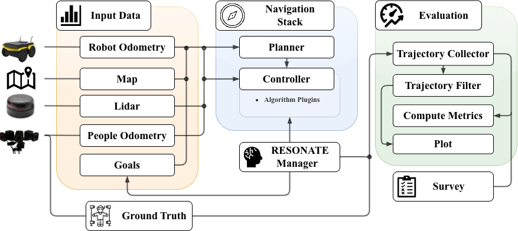

[](https://docs.ros.org/en/humble/)
[](https://navigation.ros.org/)
[](https://www.gnu.org/licenses/gpl-3.0)
# RESONATE

**RESONATE: a Real Social Navigation Testbed for Autonomous Service Robots**

RESONATE is a ROS 2 and Nav2-based benchmark for evaluating socially aware navigation on a real mobile robot. The benchmark was designed around a shared hardware platform, a common navigation stack, precise motion-capture ground truth, reusable local-controller baselines, and a fixed set of human-robot interaction scenarios.

This checkout contains the ROS 2 packages, controller baselines, maps, launch files, and benchmark goal configuration. Experimental bags, processed metrics, and survey data are expected to be added separately when reproducing or extending the benchmark.

<p align="center">
  
</p>

## Repository Contents

```text
RESONATE/
+-- resonate_navigation/
|   +-- behavior_trees/          # Nav2 behavior trees
|   +-- config/
|   |   +-- nav_params/          # Controller-specific Nav2 parameter files
|   |   +-- resonate_goals_and_poses.yaml
|   +-- launch/                  # Nav2, VICON, and benchmark launch files
|   +-- maps/                    # Scenario maps
|   +-- recording_script/        # Goal dispatch and ROS 2 bag recording script
|   +-- rviz/                    # RViz configuration
|   +-- LICENSE                  # GPL-3.0 license for the navigation package
+-- nav2_controller_baselines/
    +-- common_utils/            # Shared controller utilities
    +-- social_force_window_planner/  # DWA with the social  ritic
    +-- mppi_social_critics/     # MPPI social critic
    +-- orca_controller/         # ORCA Nav2 controller plugin
    +-- sfm_controller/          # Social Force Model Nav2 controller plugin
    +-- nav2_social_costmap_plugin/ # Gausian Costmap plugin
```

## Benchmark Summary

The benchmark uses a Clearpath Jackal equipped with a 2D LiDAR and localized through a VICON motion-capture system. Human participants are also tracked by VICON using wearable reflective-marker frames, providing ground-truth trajectories for both the robot and nearby people.

The benchmark compares these controller configurations:

| Configuration | Description |
| --- | --- |
| `DWA` | Dynamic Window Approach with local obstacle detection |
| `DWAGSC` | DWA with a Gaussian social costmap around people |
| `SFM-DWA` | DWA with an SFM-based social-work critic |
| `MPPI` | Model Predictive Path Integral controller with local obstacle detection |
| `MPPIGSC` | MPPI with a Gaussian social costmap around people |
| `SFM-MPPI` | MPPI with an SFM-based social-work critic |
| `ORCA` | Optimal Reciprocal Collision Avoidance controller |
| `SFM` | Social Force Model controller |

The supplied scenario configuration covers:

| YAML key | Scenario |
| --- | --- |
| `passing` | One person walks in the opposite direction in a hallway |
| `overtaking` | The robot overtakes a person walking in the same direction |
| `crossing1` | Two people cross from the same side with a delay |
| `crossing2` | Two people cross from opposite starting sides |
| `crossing3` | Three people cross in a diagonal/X-shaped pattern |
| `narrow_turn` | The robot and a person meet near a narrow turn |
| `mixed` | A room with stationary and crossing people |
| `curious_person` | One person actively approaches or blocks the robot path |

## Requirements

The benchmark is intended for a ROS 2 Humble workspace on Ubuntu 22.04.

Core dependencies:

- ROS 2 Humble
- Nav2
- Clearpath Jackal ROS 2 packages
- VICON/mocap packages used by the launch files:
  - `mocap4r2_vicon_driver`
  - `mocap4r2_robot_localization`
  - `mocap4r2_people`
- `people_msgs`
- `twist_stamper`
- `xtensor` and `xsimd`, required by the MPPI social critic
- OpenCV development libraries, required by `common_utils`
- LightSFM headers and libraries, required by the SFM controller and social critics

The ORCA controller fetches RVO2 at build time through CMake `FetchContent`.
The DWA implementation is provided as an adapted version of the original ROS2 Foxy implementation, with the necessary changes to make it compatible with ROS2 Humble.

The Gaussian Social Costmap is also a slightly modified version of the original
version provided.


External source repositories used by the current codebase:


- `people_msgs`: https://github.com/wg-perception/people.git, ROS 2 branch
- RVO2: https://github.com/snape/RVO2.git, fetched automatically by the ORCA controller build
- LightSFM: https://github.com/robotics-upo/lightsfm
- Original DWA implementation (for reference): https://github.com/robotics-upo/social_force_window_planner.git
- Original Gaussian Social Costmap Plugin (for reference): https://github.com/robotics-upo/nav2_social_costmap_plugin.git

## Installation

Create a ROS 2 workspace and clone this repository into `src`:

```bash
mkdir -p ~/resonate_ws/src
cd ~/resonate_ws/src
git clone https://github.com/PIC4SeR/RESONATE.git
cd ~/resonate_ws
rosdep install --from-paths src --ignore-src -r -y
colcon build --symlink-install
source install/setup.bash
```

If you are building in an existing workspace, source your ROS 2 installation first:

```bash
source /opt/ros/humble/setup.bash
```

## Running a Benchmark Trial

Start the VICON acquisition pipeline:

```bash
ros2 launch resonate_navigation resonate_acquire_vicon_messages.launch.py \
  namespace:=jackal \
  launch_rviz:=True
```

Start Nav2 with a selected map and controller parameter file:

```bash
ros2 launch resonate_navigation resonate_start_nav_stack.launch.py \
  namespace:=jackal \
  use_namespace:=true \
  map:=test_v1_v2.yaml \
  params_file:=DWA_params.yaml
```

Available controller parameter files are:

```text
DWA_params.yaml
DWA_gsc_params.yaml
DWA_SFM_params.yaml
MPPI_params.yaml
MPPI_gsc.yaml
MPPI_SFM_params.yaml
ORCA_params.yaml
SFM_params.yaml
```

Send the benchmark goal and record the ROS 2 bag:

```bash
python3 src/RESONATE/resonate_navigation/recording_script/resonate_data_recording_and_goal_setting.py \
  --goals src/RESONATE/resonate_navigation/config/resonate_goals_and_poses.yaml \
  --case passing \
  --scenario 1 \
  --algo DWA \
  --namespace jackal
```

The recorder writes bags under:

```text
bag_for_video/<case>/<algo>/scenario_<scenario>
```

The script records VICON odometry, people tracks, robot odometry, command velocity, scan data, transforms, and the published objective.

The recorder is currently kept as a source script rather than installed as a ROS 2 console executable, so run it from the checkout path shown above unless the package install rules are extended.

## Maps and Scenarios

The scenario goals, maps, robot dynamics, and tracked people are configured in:

```text
resonate_navigation/config/resonate_goals_and_poses.yaml
```

Each scenario entry defines:

- the robot goal in the `map` frame
- the map YAML file
- robot dynamic limits used by the evaluation workflow
- the people IDs to include in the metric computation

## Evaluation Metrics

The benchmark uses quantitative and qualitative metrics.

Navigation metrics:

- Success Rate (`SR`)
- Path Length (`PL`)
- Time to Goal (`TTG`)
- Cumulative Heading Changes (`CHC`)

Social metrics:

- Average Minimum Distance to the closest agent (`AMD`)
- Social Work per Step (`SWstep`)
- Proxemics time in public, social, personal, and intimate zones

Human survey metrics:

- Safety (`SA`)
- Friendliness (`FR`)
- Naturalness (`NA`)
- Avoidance foresight (`AF`)

In the RA-M benchmark results, `DWAGSC` achieved the highest overall reliability, while `SFM-MPPI` provided the best balance between robustness, navigation efficiency, and social acceptance.

## Extending RESONATE

To add a new controller:

1. Implement it as a Nav2 controller plugin or critic plugin.
2. Export the plugin description in the package manifest and CMake configuration.
3. Add a parameter file under `resonate_navigation/config/nav_params/`.
4. Run it against the same maps, goals, and scenario protocol used by the provided baselines.
5. Evaluate only successful runs for trajectory metrics, and include all runs in the success-rate calculation.


## License

The `resonate_navigation` package includes a GPL-3.0 license file and declares `GPL` in its package manifest.
